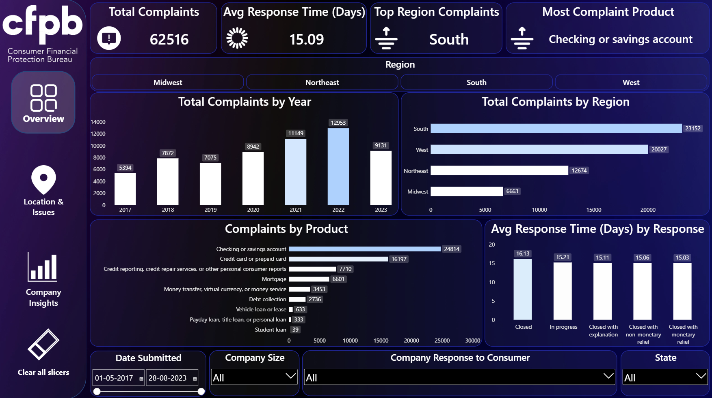
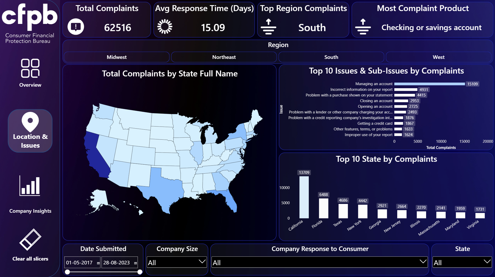
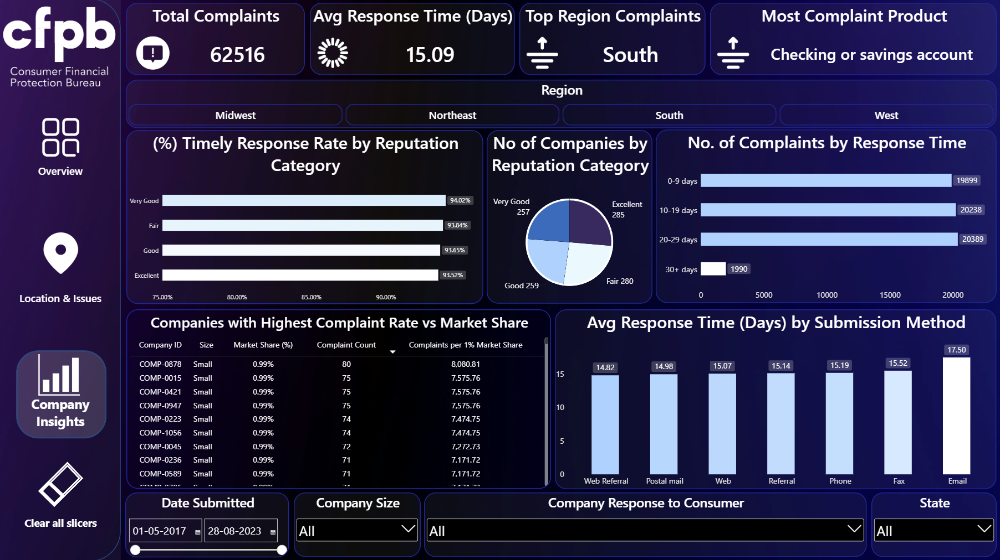

# 🏦 Consumer Financial Complaints Dashboard (Power BI)

A 3-page interactive Power BI dashboard that analyzes **62,516 consumer complaints** about financial products and companies: **what** people complain about, **where** they are, and **how well** companies respond.

🔗 **LinkedIn post:** [View the post](https://lnkd.in/p/d_XrKAi4)

---

## 📸 Dashboard Preview

### Overview


### Location & Issues


### Company Insights


---

## ❓ Business Questions Answered

- How have complaints changed over time?
- Which states and regions have the most complaints?
- Which products and issues cause the most complaints?
- How fast and how well do companies respond?
- Does company size, reputation or submission channel change the outcome?
- Which companies have the highest complaints compared to their market share?

---

## 🔍 Key Insights

*(Data period: May 2017 to Aug 2023, all numbers from the full dataset)*

- 📋 **62,516 complaints** across **1,081 companies**
- 📈 Complaints rose from **5,394 (2017)** to a peak of **12,953 (2022)**. 2023 only runs until August.
- 🏧 **Checking or savings accounts** are the top product (**39.7%**), followed by credit cards/prepaid cards (**25.9%**) and credit reporting (**12.3%**)
- ⚠️ **"Managing an account"** is the most common issue (**24.2%** of all complaints)
- 🌎 The **South** has the most complaints (**37.0%**), followed by the West (**32.0%**)
- 🗺️ **California** alone has **21.9%** of complaints, then Florida (10.4%) and Texas (7.5%)
- ⏱️ Average response time is **15.1 days**, and **96.1%** of answered complaints got a timely response
- 🤝 **65.7%** closed with explanation, **23.5%** with monetary relief, **8.4%** with non-monetary relief
- 💻 **72.7%** of complaints come through the **web**, and response time is about 15 days for every channel
- 🏢 Complaint counts per company are similar (**32 to 83**), so **small companies with tiny market share** (about 0.01%) top the "complaints per 1% share" list
- 🔎 Company reputation score and enforcement history show **almost no link** to timely response rate

---

## 🛠️ Tools & Skills Used

- **Power BI Desktop**: dashboard design, slicers, shape map, custom page navigation, "Clear all slicers" buttons
- **DAX**: measures such as Total Complaints, Avg Response Time, Most Complaint Product, Top Region
- **Data Modeling**: fact table + company dimension table joined on Company ID
- **Excel**: source dataset

---

## 🗂️ Data Model

| Table | Type | Rows |
|---|---|---|
| Complaints (Fact) | Fact | 62,516 |
| Company | Dimension | 1,081 |

---

## 📁 Repo Contents

```
├── README.md
├── Financial_Complaints_Dashboard.pbix
├── Consumer_Financial_Complaints_Dataset_-_October_2025.xlsx
└── Screenshots/
```

## ▶️ How to Open

1. Download `Financial_Complaints_Dashboard.pbix`
2. Open it in **Power BI Desktop** (free)

---

## 👤 Author

**Darshan Vaghela** | Aspiring Data Analyst
🔗 [LinkedIn](https://www.linkedin.com/in/darshanvaghela9/) | 💻 [GitHub](https://github.com/DarshanVaghela97/)
